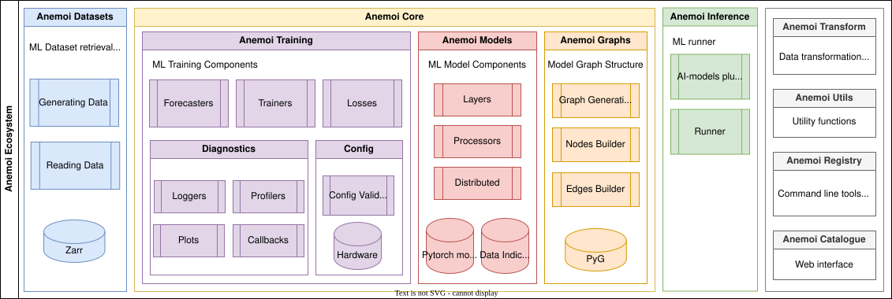

.. _index:

####################################
 Welcome to Anemoi's documentation!
####################################

The *Anemoi* framework provides a complete toolkit to develop
data-driven weather models – from data preparation through to inference.
`The development is primarily driven by a number of European Meterological Organisations
<https://github.com/ecmwf/anemoi-core/blob/main/CONTRIBUTORS.md#contributing-organisations>`_
but open to contributions from any organisation or any individual.
The framework is composed of several packages which target the different
components necessary to construct data-driven weather models. To aid
development and deployment, each package collects metadata that can be
used by the subsequent packages. The framework builds upon on
established Python tools including `PyTorch <https://pytorch.org>`_,
`Lighting <https://lightning.ai/pytorch-lightning>`_, `Hydra
<https://hydra.cc>`_, `Zarr <https://zarr.dev>`_, `Xarray
<https://xarray.dev>`_ and `earthkit
<https://earthkit.readthedocs.io/>`_.

Possible uses of *Anemoi* are for developing:

-  Global deterministic forecast models
-  Regional deterministic forecast models (limited-area models or
   stretched grids)
-  Coupled atmospheric and ocean models
-  Downscaling models
-  Ensemble/probabilistic models

######################################
 What is it for, and what is it not?
######################################
Anemoi started out as a codebase for building data-driven weather forecasting models. Since then, it has evolved to include additional *tasks*, such as downscaling (superresolution), time interpolation (temporal downscaling), and autoencoding. What these applications share is the need to build models in which information must be gathered, exchanged, and processed across the spatial dimension. For these use cases, scalable and parallelisable graph and transformer tooling is particularly valuable.

Anemoi is not intended to address all Earth-system ML problems. Problems that focus on strictly local networks or on processing long temporal signals (e.g. LSTMs) share little in common with Anemoi’s current focus, and the framework is therefore unlikely to provide significant benefits for those use cases.

################
 Who is it for?
################
Anemoi’s primary developers are based in operational meteorological centres, where it is used to create operational data-driven models. Many of these developers are also users of the framework, building and deploying models in practice. This user group places a strong emphasis on structure and reproducibility, in particular the ability to recreate the *same* model as Anemoi evolves and expands.

Anemoi also aims to serve the wider research community by enabling users to test new methods for training data-driven forecasting systems. This user group places greater emphasis on flexibility, allowing ideas to be easily adapted and tested.

##########
 Awards
##########

🏆 *Anemoi* is the winner of the `EMS Technology Achievement Award
2025 <https://www.emetsoc.org/ems-technology-achievement-award-2025-for-anemoi/>`_.

🏆 *Anemoi* won the `2025 HPCwire Readers' Choice
Award <https://www.hpcwire.com/2025-hpcwire-awards-readers-editors-choice/>`_
for "Best Use of AI Methods for Augmenting HPC Applications."

##########
 License
##########

*Anemoi* is available under the open source `Apache License`__.

.. __: http://www.apache.org/licenses/LICENSE-2.0.html

####################
 How to Cite Anemoi
####################

If you use Anemoi in your work, we recommend you cite the following
paper as the recommended reference: `Lang, Simon, et al. "AIFS --
ECMWF's Data-Driven Forecasting System." arXiv, 2024`__.

.. __: https://arxiv.org/pdf/2406.01465

BibTeX:

.. code::

   @article{lang2024aifsecmwfsdatadriven,
   title={AIFS -- ECMWF's data-driven forecasting system},
   author={Simon Lang and Mihai Alexe and Matthew Chantry and Jesper Dramsch and Florian Pinault and Baudouin Raoult and Mariana C. A. Clare and Christian Lessig and Michael Maier-Gerber and Linus Magnusson and Zied Ben Bouallègue and Ana Prieto Nemesio and Peter D. Dueben and Andrew Brown and Florian Pappenberger and Florence Rabier},
   year={2024},
   eprint={2406.01465},
   archivePrefix={arXiv},
   primaryClass={physics.ao-ph},
   url={https://arxiv.org/abs/2406.01465}
   }

###########################
 Publications using Anemoi
###########################

Below are papers in meteorology and related fields whose authors used
*Anemoi*, either its packages or models built and trained with it. The
list includes both peer-reviewed papers and preprints that have not yet
been peer reviewed. If you know of a paper that should be
added, please suggest it with a pull request to
https://github.com/ecmwf/anemoi-docs.

***************
 Peer-reviewed
***************

-  Moldovan, G., Pinnington, E., Prieto Nemesio, A., et al. (2026).
   `AIFS Single 1.1.0: an update to ECMWF's machine-learned weather
   forecast model AIFS <https://doi.org/10.5194/gmd-19-4703-2026>`__.
   *Geoscientific Model Development* 19, 4703–4724 (preprint:
   arXiv:2509.18994).

-  Wijnands, J. S., Van Ginderachter, M., François, B., Buurman, S.,
   Termonia, P., Van den Bleeken, D. (2026). `Data-driven regional
   weather forecasting: A comparison of stretched-grid and limited-area
   modelling <https://doi.org/10.1016/j.mlwa.2026.100887>`__. *Machine
   Learning with Applications* 24, 100887 (preprint: arXiv:2507.18378).

-  Nipen, T. N., Haugen, H. H., Ingstad, M. S., et al. (2026). `Regional
   Data-Driven Weather Modeling with a Global Stretched Grid
   <https://doi.org/10.1175/AIES-D-25-0001.1>`__. *Artificial
   Intelligence for the Earth Systems* 5(2) (preprint:
   arXiv:2409.02891).

-  Miralles, O., Nerini, D., Bhend, J., Raoult, B., Spirig, C. (2026).
   `Observation-Guided Interpolation Using Graph Neural Networks for
   High-Resolution Operational Nowcasting in Switzerland
   <https://doi.org/10.1175/AIES-D-25-0081.1>`__. *Artificial
   Intelligence for the Earth Systems* 5(2) (preprint:
   arXiv:2509.00017).

-  Yu, Y., Huang, L., Calotoiu, A., Hoefler, T. (2026). `Scaling Laws of
   Global Weather Models <https://arxiv.org/abs/2602.22962>`__.
   *International Conference on Machine Learning (ICML 2026)*, accepted
   (preprint: arXiv:2602.22962).

-  Lang, S., Alexe, M., Clare, M. C. A., et al. (2026). `AIFS-CRPS:
   ensemble forecasting using a model trained with a loss function based
   on the continuous ranked probability score
   <https://doi.org/10.1038/s44387-026-00073-7>`__. *npj Artificial
   Intelligence* 2, article 18 (preprint: arXiv:2412.15832).

-  Baño-Medina, J., Sengupta, A., Steinhoff, D., et al. (2025). `A
   regional high resolution AI weather model for the prediction of
   atmospheric rivers and extreme precipitation
   <https://doi.org/10.1038/s41612-025-01265-9>`__. *npj Climate and
   Atmospheric Science* 8, article 385.

***********
 Preprints
***********

-  Lima, E., Sutterud, H., Blake, L., Ulimoen, M., Mousing, E. A.
   (2026). `EMEPai 1.0.0: A fast regional data-driven air-quality
   forecast model for Europe
   <https://doi.org/10.5194/egusphere-2026-5855>`__. *EGUsphere
   preprint egusphere-2026-5855, under review at Geoscientific Model
   Development*.

-  Pennino, A., Zanetta, F., Cattaneo, M., et al. (2026).
   `Varda-single-1.0: deterministic data-driven weather forecasting at 1
   km resolution over Switzerland's complex topography
   <https://arxiv.org/abs/2610.01835>`__. *arXiv preprint
   arXiv:2610.01835*.

-  Rouzegari, N., Afzali Gorooh, V., Sengupta, A., et al. (2026).
   `West-WRF AI 2-km: High-Resolution Prediction of Integrated Vapor
   Transport and Precipitation <https://arxiv.org/abs/2609.25512>`__.
   *arXiv preprint arXiv:2609.25512*.

-  Partio, M., Hieta, L., Laine, O. (2026). `From Nowcasting to
   Forecasting: Adapting a Reanalysis-Trained Cloud Cover Model to
   Observations <https://arxiv.org/abs/2609.03763>`__ (CloudCast v2).
   *arXiv preprint arXiv:2609.03763*.

-  Schmitt, J. F., Delorme, B., King, R. C., et al. (2026). `Improving
   global precipitation forecasts with an AI weather model trained on
   satellite observations <https://arxiv.org/abs/2609.03210>`__. *arXiv
   preprint arXiv:2609.03210*.

-  Lang, S., Leutbecher, M., Hatfield, S. (2026). `On the sensitivity of
   machine-learned probabilistic weather forecast models to scale-aware
   scoring rules <https://arxiv.org/abs/2607.19161>`__. *arXiv preprint
   arXiv:2607.19161*.

-  Ingstad, M. S., Clare, M. C. A., Ersland, O., et al. (2026).
   `HourGlass: A probabilistic data-driven temporal downscaler for
   global and regional weather forecasting
   <https://arxiv.org/abs/2607.11457>`__. *arXiv preprint
   arXiv:2607.11457*.

-  Lean, P., Pinnington, E., Laloyaux, P., et al. (2026). `Global
   reanalysis from observations alone with machine learning
   <https://arxiv.org/abs/2607.07879>`__. *arXiv preprint
   arXiv:2607.07879*.

-  Schloer, J., Tietsche, S., Roberts, C. D., et al. (2026).
   `AIFS-SUBS: Extending Data-Driven Forecasting to Sub-Seasonal
   Timescales <https://arxiv.org/abs/2607.05100>`__. *arXiv preprint
   arXiv:2607.05100*.

-  Bakketun, Å., Haugen, H. H., Blyverket, J., Nipen, T. N., Müller, M.
   (2026). `Enhancing a high resolution data-driven weather prediction
   model with surface descriptors <https://arxiv.org/abs/2607.02824>`__.
   *arXiv preprint arXiv:2607.02824*.

-  Pinnington, E., Lean, P., Alexe, M., et al. (2026). `AIFS-DOP:
   End-to-End Medium-Range Weather Prediction from Observations Alone
   with Machine Learning <https://arxiv.org/abs/2606.19093>`__. *arXiv
   preprint arXiv:2606.19093*.

-  Nie, Y., Sengupta, A., Steinhoff, D. F., Baño-Medina, J., et al.
   (2026). `High-resolution large ensemble for extreme precipitation
   forecasting with multiple AI weather models
   <https://doi.org/10.21203/rs.3.rs-9889566/v1>`__. *Research Square
   preprint, under review*.

-  Hahner, S., Zampieri, L., Bidlot, J.-R., et al. (2026). `Representing
   the Surface Ocean in ECMWF's data-driven forecasting system AIFS
   <https://arxiv.org/abs/2604.25559>`__. *arXiv preprint
   arXiv:2604.25559*.

-  Polichtchouk, I., Clare, M. C. A., Chantry, M., et al. (2026).
   `Hybrid weather prediction using spectral nudging toward
   machine-learning forecasts <https://arxiv.org/abs/2604.22522>`__.
   *arXiv preprint arXiv:2604.22522*.

-  Dumont Le Brazidec, J., Lang, S., Leutbecher, M., et al. (2026).
   `Downscaling weather forecasts from Low- to High-Resolution with
   Diffusion Models <https://arxiv.org/abs/2604.03303>`__. *arXiv
   preprint arXiv:2604.03303*.

-  Harder, P., Flemming, J., Alexe, M., Mertes, G., Raoult, B., Chantry,
   M. (2026). `AIFS-COMPO: A Global Data-Driven Atmospheric Composition
   Forecasting System <https://arxiv.org/abs/2604.03300>`__. *arXiv
   preprint arXiv:2604.03300*.

-  Polichtchouk, I., Lang, S., Lock, S.-J., Maier-Gerber, M., Dueben, P.
   (2026). `Hybrid ensemble forecasting combining physics-based and
   machine-learning predictions through spectral nudging
   <https://arxiv.org/abs/2603.05570>`__. *arXiv preprint
   arXiv:2603.05570*.

-  Kristensen, N. M., Matuszak, M., Tedesco, P., Kullmann, I. K. B.,
   Röhrs, J. (2026). `Flo: A data-driven limited-area storm surge model
   <https://arxiv.org/abs/2601.02090>`__. *arXiv preprint
   arXiv:2601.02090*.

-  Nordhagen, E. M., Haugen, H. H., Ingstad, M. S., et al. (2026).
   `High-Resolution Probabilistic Data-Driven Weather Modeling with a
   Stretched Grid <https://arxiv.org/abs/2511.23043>`__. *arXiv preprint
   arXiv:2511.23043*.

-  Lang, S., Leutbecher, M., Maciel, P. (2025). `A multi-scale loss
   formulation for learning a probabilistic model with proper score
   optimisation <https://arxiv.org/abs/2506.10868>`__. *arXiv preprint
   arXiv:2506.10868*.

-  Lang, S., Alexe, M., Chantry, M., et al. (2024). `AIFS – ECMWF's
   data-driven forecasting system <https://arxiv.org/abs/2406.01465>`__.
   *arXiv preprint arXiv:2406.01465*.

.. toctree::
   :maxdepth: 1
   :caption: Getting Started

   Introduction <self>
   getting-started/package-descriptions.rst
   getting-started/installing.rst
   getting-started/tour.rst

.. toctree::
   :maxdepth: 1
   :caption: Contributing

   contributing/contributing.rst
   contributing/governance.rst
   contributing/roadmap.rst
   contributing/environment.rst
   contributing/guidelines.rst
   contributing/code_style.rst
   contributing/testing.rst
   contributing/documentation.rst

.. toctree::
   :maxdepth: 1
   :caption: Anemoi Package Documentation

   anemoi-datasets <https://anemoi.readthedocs.io/projects/datasets/>
   anemoi-graphs <https://anemoi.readthedocs.io/projects/graphs/>
   anemoi-inference <https://anemoi.readthedocs.io/projects/inference/>
   anemoi-models <https://anemoi.readthedocs.io/projects/models/>
   anemoi-registry <https://anemoi.readthedocs.io/projects/registry/>
   anemoi-training <https://anemoi.readthedocs.io/projects/training/>
   anemoi-transform <https://anemoi.readthedocs.io/projects/transform/>
   anemoi-utils <https://anemoi.readthedocs.io/projects/utils/>
